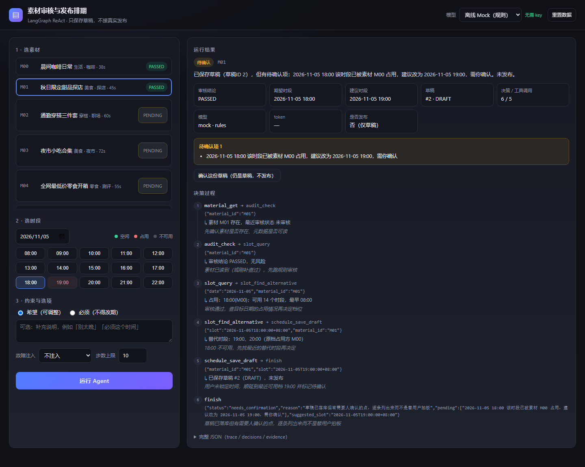
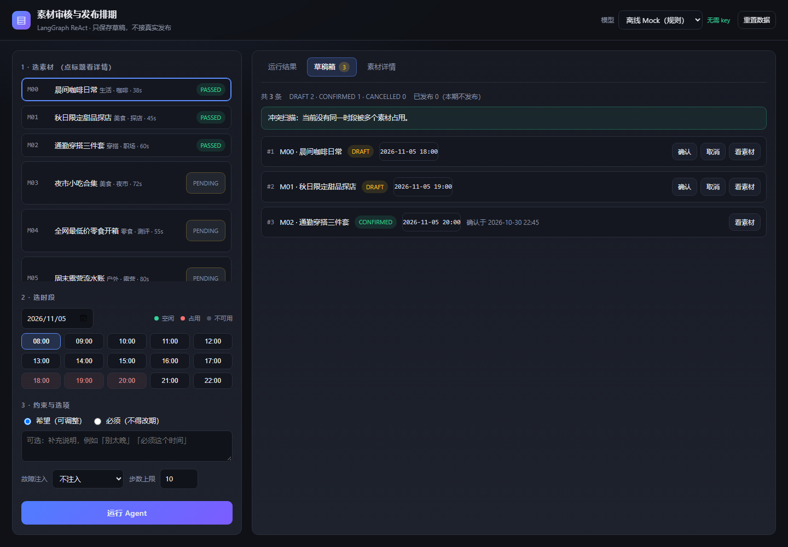
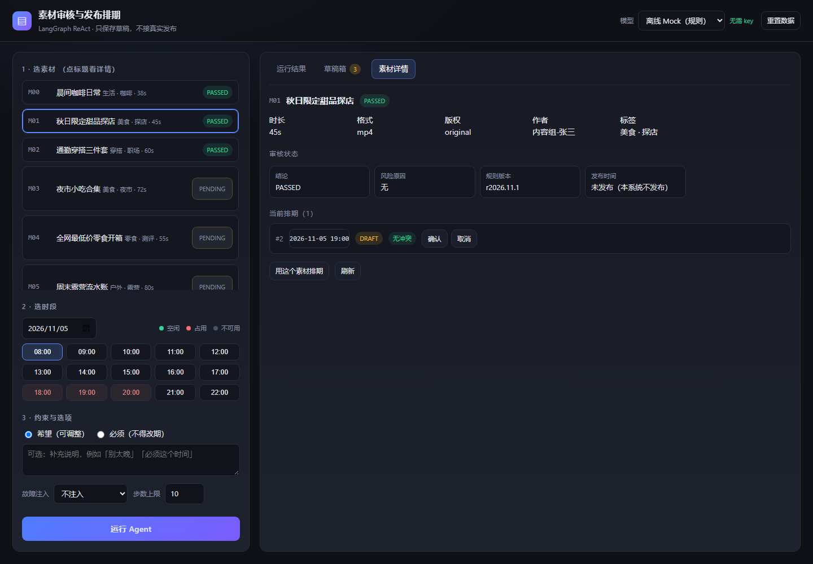
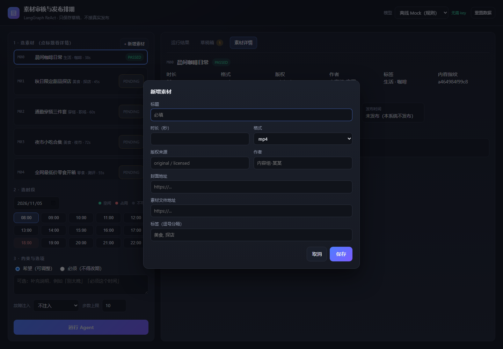

# 素材审核与发布排期 Agent（LangGraph · ReAct · mock 模式）

小影校招笔试交付。按 [题目](题目.md) 实现：帮内容团队找出待处理素材，审出风险，形成无冲突、可确认的发布排期。
**只保存草稿，不接真实发布；决策循环是真实的，但模型默认是离线 Mock。**

- 决策循环：[LangGraph](https://langchain-ai.github.io/langgraph/) 的 `prepare → agent ⇄ act → finalize`，模型每轮读工具观测再决定下一步
- 存储：JSON 单文件数据库，**MySQL 设计保留在 [`sql/schema.sql`](sql/schema.sql)**，两者字段与约束一一对应
- 判定：审核规则、时段占用、幂等全部是确定性代码；模型只负责「选哪个动作、什么时候收手」
- 工具：`@tool` 装饰器声明 + 扫描 `src/toolbox/` 自动注册，新增动作只改一个文件
- 限步：`max_steps` 默认 10，超限返回 `step_limit_reached`（明确的未完成状态）
- 界面：本地 Web 应用（标准库 HTTP + 单页前端），`python -m src.server` 打开即用

> 分工：**设计（数据模型、主流程、边界与验收标准）由我拍板**，编码由 AI 按约束实现、我负责验收与返工；
> 逐条证据见 [AI 使用说明](docs/04-ai-usage.md)。

## 安装

### 0 · 前置要求

| 需要 | 说明 |
| --- | --- |
| Python **3.10+** | `python --version` 能看到 3.10 及以上 |
| git | 用来 clone |
| 数据库 / API key | **都不需要**。默认离线 Mock，`data/seed.json` 就是数据库 |

### 1 · 克隆仓库

```sh
git clone <你的仓库地址>
cd <仓库目录>
```

### 2 · 建虚拟环境并安装依赖

Windows（PowerShell）：

```powershell
python -m venv .venv
.\.venv\Scripts\Activate.ps1
pip install -r requirements.txt
```

macOS / Linux：

```bash
python3 -m venv .venv
source .venv/bin/activate
pip install -r requirements.txt
```

装完确认一下：

```powershell
python -c "import importlib.metadata as m; print(m.version('langgraph'))"
# 1.2.18
```

两个常见卡点：

- **Activate 被拦**（`无法加载文件 ... 在此系统上禁止运行脚本`）：先执行 `Set-ExecutionPolicy -Scope Process Bypass -Force`；
- **不想激活也行**：后面所有 `python` 换成 `.\.venv\Scripts\python.exe`（Windows）或 `.venv/bin/python`（macOS/Linux）。

### 3 ·（可选）配置模型

**默认什么都不用配**：`LLM_PROVIDER=mock`，走规则策略，不联网、不花钱，先确认流程能跑通。

想用真实模型再配：

```powershell
Copy-Item .env.example .env      # macOS/Linux: cp .env.example .env
```

编辑 `.env`：

```ini
LLM_PROVIDER=deepseek
DEEPSEEK_API_KEY=sk-你的key
DEEPSEEK_MODEL=deepseek-flash
```

配置**只从 `.env` 读**（代码里统一 `os.getenv`），不需要 `export`；改完文件下次运行就生效。
`.env` 已在 `.gitignore` 里，不会被提交。

### 4 · 先跑一条命令，确认环境通了

```powershell
python -m src.main --input examples/normal.input.json --compact
```

期望输出里 `status` 是 `completed`、`published` 是 `false`：

```json
{"status":"completed","mode":"mock_react","material_id":"M02","draft":{"saved":true,"draft_id":2,"status":"DRAFT"},"published":false,"steps":5,"tool_calls":4,...}
```

想更彻底一点，跑一遍测试（155 个用例，约 12 秒）：

```powershell
python -m unittest discover -s tests -v
```

### 5 · 启动 Web 应用

```powershell
python -m src.server
```

终端会打印：

```
[web] 排期 Agent 界面已启动：http://127.0.0.1:8765
[web] 数据库：...\var\web-db.json（可用界面上的「重置数据」回到种子状态）
```

浏览器通常会自动打开；没开就手动访问 **<http://127.0.0.1:8765>**。

常用变体：

```powershell
python -m src.server --port 9000          # 换端口
python -m src.server --no-open            # 不自动开浏览器
python -m src.server --provider deepseek  # 默认用真实模型（界面右上角也能切）
```

### 6 · 界面上手（30 秒）

1. 左侧点 **M01 秋日限定甜品探店** → 右侧自动切到「素材详情」，先看它的审核态与已有排期；
2. 时段网格点 **18:00**（红底 = 已被 M00 占用，**仍然可以选**，正好用来看 Agent 怎么处理冲突）；
3. 约束保持「希望（可调整）」，点 **运行 Agent**；
4. 「运行结果」显示：`待确认`、草稿 #2 落在 **19:00**、一条待确认项、`published=false`，下面是完整决策时间线；
5. 点 **确认这份草稿**（页面不跳转，草稿状态就地更新）；切到「草稿箱」能看到它从 `DRAFT` 变成 `CONFIRMED`，`published` 仍然是 `false`；
6. 想重来：右上角 **重置数据**。

### 7 · 停止

终端 `Ctrl+C`。运行库在 `var/web-db.json`，删掉或点「重置数据」都会回到种子状态。

## 常见问题

| 现象 | 原因与解法 |
| --- | --- |
| `ModuleNotFoundError: No module named 'langgraph'` | 用了系统 python 而不是虚拟环境里的；用 `.\.venv\Scripts\python.exe` 或先激活 |
| `ModuleNotFoundError: No module named 'src'` | 不在仓库根目录；`python -m src.*` 要求 cwd 是仓库根 |
| `Activate.ps1`「禁止运行脚本」 | `Set-ExecutionPolicy -Scope Process Bypass -Force`，或直接用 venv 里 python 的全路径 |
| 端口 8765 被占用 | `python -m src.server --port 9000` |
| 界面显示「未配置 DEEPSEEK_API_KEY」 | `.env` 没填 key 或不在仓库根；可先用 Mock 跑 |
| `pip install` 报 `UnicodeDecodeError` | 老版本 `requirements.txt` 带中文注释导致 pip 用 cp936 解码；更新到最新提交（已改 ASCII） |
| 示例日期看着"过期" | 示例把 `now` 冻在输入里，不依赖真实时间，属于设计 |

## 界面能做什么

左侧选素材、选时段（占用时段也能选，用来看 Agent 怎么处理冲突）、选硬/软约束；右侧三个标签页：
**运行结果**（决策过程）、**草稿箱**（所有排期 + 冲突扫描）、**素材详情**（单个素材的审核态、排期、与谁冲突）。



<sub>截图是真实跑 `M01 → 18:00 软性` 的结果：18:00 被 M00 占用，草稿落到 19:00 并标待确认，`published=false`。</sub>

**草稿箱**：DRAFT / CONFIRMED / CANCELLED 全量列出，可直接确认或取消（取消会释放时段），并做一次全局冲突扫描。



**素材详情**：点左侧任意素材即可看它的元数据、审核结论、所有排期，以及「这条排期有没有和别的素材撞在同一时段」；底部可直接「编辑 / 删除」。



**新增素材**：左栏「+ 新增素材」打开表单，保存即写库并立刻跑一遍审核（所以列表马上能看到 PASSED / INCOMPLETE / RISK）；内容与已有素材重复会直接 409 拒绝。



| 能力 | 说明 |
| --- | --- |
| 素材库 | 10 条合成素材，显示审核态（PASSED / PENDING / RISK）；内容重复的会多一个「重复」徽章 |
| 时段网格 | 08:00–22:00，free / occupied / closed 三态；占用档可选，用来演示冲突 |
| 参数 | 硬/软约束、补充说明、故障注入（素材不可用 / 保存失败 / 提醒失败）、步数上限 |
| 运行结果 | 状态徽章、草稿 ID、待确认项、规则命中、token 用量、完整决策时间线 |
| 草稿箱 | 全部排期 + 状态计数 + 冲突扫描；DRAFT 可确认/取消 |
| 素材详情 | 元数据、审核结论与风险原因、该素材的排期、是否与别的素材冲突 |
| 素材增删改查 | 左栏「+ 新增素材」建；详情页「编辑 / 删除」改和删；写入即自动审核 |
| 一键操作 | `POST /api/confirm` / `POST /api/cancel`（仍是草稿，不发布） |
| 重置数据 | 一键把运行库恢复到种子状态 |

接口：`GET /api/bootstrap`、`GET /api/slots?date=`、`GET /api/drafts`、`GET /api/materials/{id}`、
`POST /api/materials`、`PUT /api/materials/{id}`、`DELETE /api/materials/{id}`、
`POST /api/run`、`POST /api/confirm`、`POST /api/cancel`、`POST /api/reset`。
只监听 `127.0.0.1`，无鉴权——本地面向评审的演示，不要暴露到公网。

## 命令行用法

装好依赖后，CLI 与 Web 是同一套流程，只是入口不同：

```sh
python -m src.main --input examples/normal.input.json          # 正常排期 → completed
python -m src.main --input examples/conflict.input.json        # 18:00 被占，建议 19:00 → needs_confirmation
python -m src.main --input examples/hard-conflict.input.json   # 硬性要求不被改动 → blocked
python -m src.main --input examples/missing.input.json         # 缺封面 → needs_input
python -m src.main --input examples/risk.input.json            # 敏感词 → blocked
python -m src.main --input examples/duplicate.input.json       # 重复提交只产生一份草稿
python -m src.main --input examples/save-failure.input.json    # 保存失败明确报错
python -m src.main --input examples/tool-failure.input.json    # 工具失败
python -m src.main --input examples/metadata-lag.input.json    # 元数据延迟 → 补查后重审再排
python -m src.main --input examples/not-found.input.json       # 素材不存在
python -m src.main --input examples/duplicate-material.input.json  # 同文件换 ID 重传 → R009 阻断

# 决策日志（每行一轮：动作 / 参数 / 观测摘要 / 后续 / 依据）
python -m src.main --input examples/conflict.input.json --log examples/run-record-soft-conflict.jsonl

# 限步演示：正常要 7 步，卡到 2 步会返回未完成
python -m src.main --input examples/metadata-lag.input.json --max-steps 2

python -m unittest discover -s tests -v                        # 155 个用例
```

成功输出 JSON；业务异常（缺字段、风险、冲突、保存失败）以 JSON 的 `status` 返回，退出码 0；
入参本身不合法（不是 JSON 对象、字段类型错）退出码 2 并输出 `{"status":"invalid_input"}`。

其它参数：

| 参数 | 作用 |
| --- | --- |
| `--db var/db.json` | 持久化到指定文件（默认用临时库，保证示例可复现） |
| `--now 2026-11-05T09:00:00+08:00` | 注入当前时间，便于复现示例 |
| `--compact` | 单行 JSON 输出 |
| `--max-steps N` | 工具调用次数上限（默认 10），超限返回 `step_limit_reached` |
| `--log PATH` | 把决策日志写成 JSONL |
| `--provider mock\|deepseek` | 覆盖模型来源（默认读 `.env` 的 `LLM_PROVIDER`） |
| `--model NAME` | 覆盖模型名，如 `deepseek-v4-pro` |
| `--env-file PATH` | 指定 `.env` 路径 |

## 保存失败（验收项 6）

**定义**：审核过了、时段也定了，草稿写入 `publish_schedule` 的那一刻失败。它既不是审核不通过，也不是时段冲突，
而是"算都算完了，落库没落成"。

题目把这一项单列，是因为这里最容易出现三种作弊式实现：**谎报**（写失败却说已排期）、**半写**（留下脏数据）、
**无限重试**（把不可恢复的错误一直重试）。

### 系统怎么处理

| 错误码 | 含义 | 是否重试 | 结果 |
| --- | --- | --- | --- |
| `DB_UNAVAILABLE` | 连接不可用、超时、锁超时 | **重试一次** | 仍失败 → `tool_error` |
| `DB_WRITE_REJECTED` | 写入被拒（约束/权限） | 不重试 | 直接 `tool_error` |

四条必须成立的性质：

1. **明确失败**：`status=tool_error`、`draft.saved=false`、`published=false`，`message` 带错误码与「是否可重试」；
2. **原子性**：只回滚保存这一步，库里不会出现半条草稿（审核结论保留，因为那一步已提交）；
3. **重试纪律**：只有 `retryable` 才重试，且**只重试一次**——决策日志里能看到 `schedule_save_draft` 出现两次（可重试）
   或一次（不可重试）；
4. **不谎报**：模型若没落草稿却 `finish(completed/needs_confirmation)`，`finalize` 一律降级为 `blocked`。

### 实测

```powershell
python -m src.main --input examples/save-failure.input.json
```

```text
status=tool_error   published=false   draft.saved=false
message: 调用 DB_UNAVAILABLE 失败，已重试 1 次：… 写入未生效（可重试）。未保存任何数据。
决策: material_get → audit_check → slot_query → schedule_save_draft → schedule_save_draft → finish
```

把输入里的 `"save_failure": "db_unavailable"` 换成 `"db_write_rejected"`，决策里就只剩**一次** `schedule_save_draft`
（不可重试，不浪费一次写）。

### 和相邻验收项的区别

同样"没存下"，但语义与处置不同——别看 `status` 就下结论，要看错误码：

| 情况 | 错误码 | 是否重试 | 处置 |
| --- | --- | --- | --- |
| **保存失败**（本项） | `DB_UNAVAILABLE` / `DB_WRITE_REJECTED` | 可重试的一次 | 明确报失败 |
| 时段被别的素材占用 | `SLOT_CONFLICT` | 否 | 换时段 |
| 该素材已有排期 | `ALREADY_SCHEDULED` | 否 | 先取消原草稿 |
| 素材未过审 | `INVALID_STATE` | 否 | 阻断 |
| 高危规则命中（R005/R008/R009） | （不会走到保存） | 否 | 阻断 |

### 自己验的时候看三处

1. `draft.saved` 必须是 `false`；
2. `message` 里**不能**出现「已保存 / 已排期 / 已完成」；
3. `decisions` 里 `schedule_save_draft` 的次数符合重试策略。

> 注意退出码仍然是 **0**：保存失败是业务结果（结果里用 `status` 表达），不是调用错误；
> 只有入参本身不合法才是退出码 2。所以判断成败要看 JSON 的 `status`，别只看 shell 的退出码。

对应实现：[`src/tools.py`](src/tools.py) 的 `schedule_save_draft`（错误码与重试标记）、
[`src/store.py`](src/store.py) 的 `transaction()`（失败不落盘）、[`src/graph.py`](src/graph.py) 的 `_save_draft`（重试一次）与
`_finalize`（不谎报守卫）。测试：`test_save_failure_is_reported_loudly`、`test_rollback_leaves_no_partial_row`、
`test_finish_without_draft_is_downgraded_to_blocked`。

## ReAct 决策循环

`src/graph.py` 只做四件事：解析意图（`prepare`）、让策略选动作（`agent`）、执行动作（`act`）、汇总（`finalize`）。
`agent ⇄ act` 之间没有写死的业务分支——**下一步是什么，取决于上一步工具返回了什么**。

```
agent: 还不知道素材是否存在        → material_get(M01)
act  : 素材存在                    → observation: 存在，最近审核 未审核
agent: 有了素材，该审核了          → audit_check(M01)
act  : PASSED                      → observation: 无风险
agent: 审核过了，查目标日          → slot_query(2026-11-05)
act  : 18:00 被 M00 占            → observation: 19:00、20:00 可用
agent: 用户没说死，先找替代        → slot_find_alternative(18:00)
act  : 19:00 / 20:00              → observation: 替代时段
agent: 顺延到 19:00 但要人确认     → schedule_save_draft(M01, 19:00)
act  : 草稿 #2                    → observation: 已保存 DRAFT
agent: 收手，把待确认项交出去      → finish(needs_confirmation)
```

两条对照路径（同一素材、同一冲突，只因用户语气不同而在第 5 步分叉）：

| 输入 | 第 4 步观测 | 第 5 步动作 | 结果 |
| --- | --- | --- | --- |
| `conflict`（希望 18:00） | 替代 19:00/20:00 | `schedule_save_draft(19:00)` | 草稿 #2，待确认 |
| `hard-conflict`（必须 18:00） | 替代 19:00/20:00 | `finish(blocked)` | 不落库，交回选项 |

完整记录（含参数、观测、后续动作、决策依据）见 [examples/run-records.md](examples/run-records.md)；
机器可读版是同目录的 `run-record-*.jsonl`。

**边界**：默认 `MockPolicy` 是规则决策，它证明循环成立、判定可靠，**不证明真实模型的决策质量**。
真实模型路径 `LLMPolicy` + DeepSeek 客户端已用真实 key 跑通 3 条路径（见下节与
[run-records](examples/run-records.md#真实模型记录deepseek-deepseek-flash)）。

## 接入真实模型（DeepSeek）

```sh
# 方式一：写进仓库根的 .env（会被自动加载，行尾注释也支持）
#   DEEPSEEK_API_KEY=sk-...
#   DEEPSEEK_MODEL=deepseek-flash

# 方式二：只对当前会话生效
$env:DEEPSEEK_API_KEY = "sk-..."

python -m scripts.smoke_deepseek          # 连通性 + 工具调用两个检查点
python -m scripts.smoke_deepseek --full   # 再跑一遍完整 ReAct 示例（conflict）

python -m src.main --input examples/conflict.input.json --provider deepseek
python -m src.main --input examples/conflict.input.json --provider deepseek --model deepseek-v4-pro
python -m src.main --input examples/conflict.input.json --provider deepseek --env-file .env.local
```

已用 `deepseek-flash` 实跑 3 条路径，结论与离线 mock 一致：
软性冲突 6 步存草稿 19:00、硬性冲突 4 步 `blocked`、信息缺失 5 步 `needs_input`。
记录见 [examples/run-records.md](examples/run-records.md#真实模型记录deepseek-deepseek-flash)。

| 环境变量 | 默认 | 说明 |
| --- | --- | --- |
| `LLM_PROVIDER` | `mock` | `mock` / `deepseek` / `http`；也可用 `--provider` |
| `DEEPSEEK_API_KEY` | — | 必填（也兼容 `LLM_API_KEY`） |
| `DEEPSEEK_BASE_URL` | `https://api.deepseek.com` | 可指向代理 |
| `DEEPSEEK_MODEL` | `deepseek-flash` | 也可用 `deepseek-v4-pro` |
| `DEEPSEEK_THINKING` | `disabled` | `enabled` 时自动去掉 `temperature` |
| `DEEPSEEK_REASONING_EFFORT` | 空 | `none/low/high/max`，设置后覆盖 THINKING |
| `DEEPSEEK_TIMEOUT` / `DEEPSEEK_MAX_RETRIES` | `60` / `2` | 超时秒数与重试次数 |

配置只从 `.env` 读：程序启动时加载并写回环境，代码里统一用 `os.getenv("KEY")`；
`.env` 覆盖同名进程变量，所以**改文件就生效**，不会被 shell 里残留的旧值压掉。

实现要点（细节见 [docs/06 §2.7](docs/06-implementation.md)）：

- 走 OpenAI 兼容协议，`tools` + `tool_choice=auto`，`reasoning_content` 只读不回传；
- 工具名必须满足 `^[a-zA-Z0-9_-]+$`（DeepSeek 会 400 拒绝点号），所以统一用 `material_get` 这种下划线命名；
- 重试只针对 429 / 5xx / 超时，指数退避，尊重 `Retry-After`；400/401/402/422 立即失败；
- 模型层失败时输出 `status=tool_error` + `model_error{code,status,retryable}`，不落草稿、不谎报；
- 每轮 `usage` 累加进输出的 `llm_usage`，可直接看 token 成本。

## 项目目录

```text
.
├── README.md                     # 安装、运行、评审导航
├── requirements.txt              # 依赖（langgraph）
├── .env.example                  # 不含真实密钥；默认 mock
├── .gitignore
├── 题目.md                        # 原始题目与设计思路
├── sql/
│   └── schema.sql                # MySQL 设计（保留稿，不参与运行）
├── data/
│   └── seed.json                 # 合成素材 + 已有排期（充当数据库初始数据）
├── docs/
│   ├── 01-requirements.md         # 用户、范围、验收映射
│   ├── 02-solution.md             # ReAct 流程、模块、取舍
│   ├── 03-evaluation.md           # 用例和实际测试记录
│   ├── 04-ai-usage.md             # AI 分工、我的判断、验收证据
│   ├── 05-retrospective.md        # 用时、不足、未完成部分
│   ├── 06-implementation.md       # 实现细节（循环/动作/数据/错误码/测试）
│   └── images/                    # 界面截图
├── web/
│   ├── index.html                # 单页界面（无构建步骤）
│   ├── app.css                   # 深色主题
│   └── app.js                    # 原生 DOM：选素材/时段、运行、确认、时间线
├── src/
│   ├── main.py                   # CLI：读请求 → 跑循环 → 输出 JSON / 决策日志
│   ├── server.py                 # Web 应用：标准库 HTTP + JSON API
│   ├── graph.py                  # LangGraph：prepare → agent ⇄ act → finalize
│   ├── policy.py                 # 决策策略：MockPolicy（默认）/ LLMPolicy（tool-calling）
│   ├── clients.py                # 模型客户端：DeepSeek / OpenAI 兼容（重试、超时、错误码）
│   ├── registry.py               # 动作发现：扫描 toolbox 包 + JSON Schema + finish
│   ├── tooling.py                # @tool 装饰器、注册表、执行与观测摘要
│   ├── toolbox/                  # 每个动作一个文件，@tool 声明即注册
│   ├── tools.py                  # 工具实现（ToolResult + 错误码）
│   ├── rules.py                  # 审核规则 R001–R009（纯函数）
│   ├── llm.py                    # 意图解析：MockLLM（默认）/ HttpLLM（真实模型）
│   ├── env.py                    # .env 加载（配置唯一来源）
│   ├── repository.py             # 数据访问层（换 MySQL 只改这里）
│   ├── store.py                  # JSON 单文件库：唯一键 + 事务 + 文件锁
│   ├── util.py                   # 时区、整点对齐、幂等键
│   └── errors.py
├── tests/
│   ├── support.py                # 每个用例一份临时库
│   ├── test_store.py             # 唯一键/回滚/并发/原子写
│   ├── test_rules.py             # 规则逐条
│   ├── test_llm.py               # 意图解析 + HttpLLM 报文
│   ├── test_clients.py           # DeepSeek 报文/重试/错误码
│   ├── test_env.py               # .env 解析与优先级
│   ├── test_server.py            # Web 门面 + HTTP 路由/静态资源/错误码
│   ├── test_tooling.py           # @tool 发现、注册校验、schema 与分发
│   ├── test_workflow.py          # 六类验收 + ReAct 循环 + 限步
│   └── test_cli.py               # 退出码、跨进程幂等、--log/--max-steps
├── scripts/
│   ├── regen_examples.py         # 重新生成示例输出、决策记录与测试记录
│   ├── smoke_deepseek.py         # 真实 key 联调：连通性 + 工具调用 + 完整流程
│   └── stress_lock.py            # 文件锁并发压力脚本
└── examples/
    ├── *.input.json / *.output.json
    ├── run-record-*.jsonl        # 三条 ReAct 执行路径（机器可读）
    ├── run-records.md            # 同上，可读版
    └── test-results.txt          # 实际执行记录
```

## 怎么读输出

```jsonc
{
  "status": "needs_confirmation",        // 七种状态之一（含 step_limit_reached）
  "finished": true,                      // 流程是否走完
  "completed": true,                     // 业务目标是否达成（草稿已存）
  "review_status": "PASSED",             // 审核结论
  "suggested_slot": "2026-11-05T19:00:00+08:00",
  "pending_confirmations": ["2026-11-05 18:00 该时段已被素材 M00 占用，建议改为 2026-11-05 19:00，需你确认"],
  "draft": {"saved": true, "draft_id": 2, "status": "DRAFT", "deduped": false},
  "published": false,                    // 恒为 false：本期不接真实发布
  "steps": 6, "tool_calls": 5, "max_steps": 10,
  "decisions": [                         // 每轮模型决策，可逐条复核
    {"step": 4, "action": "slot_find_alternative", "args": {"slot": "2026-11-05T18:00:00+08:00"},
     "rationale": "18:00 不可用，先找最近的替代时段再决定",
     "observation": {"ok": true, "summary": "替代时段：19:00、20:00（原档占用方 M00）"},
     "next": "schedule_save_draft"}
  ],
  "message": "已保存草稿（草稿ID 2），但有待确认项：……未发布。"
}
```

`examples/*.output.json` 是离线 mock 的真实运行结果，不是手写样例。

## 两份设计为什么并存

| 文件 | 角色 |
| --- | --- |
| `sql/schema.sql` | **目标态设计**：真实部署用 MySQL 时的表、字段、唯一键、注释 |
| `data/seed.json` | **当前实现**：mock 模式下充当数据库的单文件，表结构与 DDL 一一对应 |

`src/store.py` 把 MySQL 的四件事——表、自增主键、唯一键、事务——用最小实现复刻出来，
`src/repository.py` 是唯一的换库边界。迁移步骤见 [实现细节 §9](docs/06-implementation.md)。

## 评审导航

| 检查项 | 入口 |
| --- | --- |
| 业务目标与范围 | [需求](docs/01-requirements.md) |
| ReAct 流程与取舍 | [方案](docs/02-solution.md) |
| 实现细节 | [实现](docs/06-implementation.md) |
| 界面 | [界面能做什么](#界面能做什么) |
| 保存失败怎么处理 | [保存失败（验收项 6）](#保存失败验收项-6) |
| 执行路径记录 | [run-records](examples/run-records.md) |
| MySQL 设计 | [schema.sql](sql/schema.sql) |
| 测试、预期、结果 | [评估](docs/03-evaluation.md) |
| AI 分工与我的判断 | [AI 使用](docs/04-ai-usage.md) |
| 用时与未完成部分 | [复盘](docs/05-retrospective.md) |

## 边界
- `published` 恒为 `false`，没有任何代码路径写 `PUBLISHED` 或 `release_date`；`status` 上限是 `CONFIRMED`（仍是草稿）。
- 硬性时间要求（「必须 18:00」）遇到冲突时**不会被自动改期**，只会把冲突和选项交回用户。
- 素材信息缺失时不猜、不填默认值，只列出缺什么。
- 默认决策是规则版 `MockPolicy`；DeepSeek 已实跑 3 条路径（单模型单次，样本不足以下质量结论）。
- 一个素材同一时刻只允许一条有效排期（DRAFT/CONFIRMED）：换时段重排会被 `ALREADY_SCHEDULED` 拒绝，结果里带出原草稿，改期需先取消。
- 同一份文件换个素材 ID 重传会被内容指纹识别（R009），审核直接判 RISK、不排期。
- 达到 `max_steps` 会返回 `step_limit_reached`，`finished=false`，不产生草稿。

