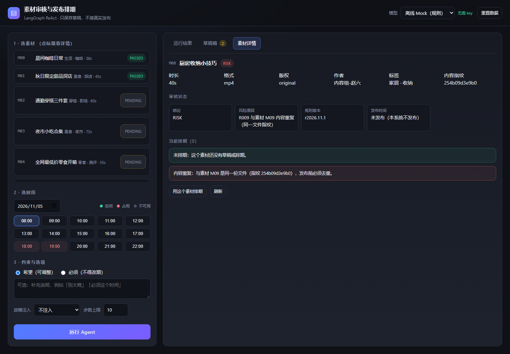

# 需求理解

| 项目 | 定义 |
|---|---|
| 用户 | 内容团队的运营/审核同学，手上有一批待发素材 |
| 价值假设 | 把「找素材 → 审风险 → 抢时段 → 反复确认」压成一到两轮对话，产出可直接执行的草稿；节省时长尚未实测 |
| 输入 | 素材 ID、元数据、发布时间要求（硬性/软性）、已有排期、审核规则 |
| 输出 | 审核状态、风险原因、建议时段、待确认项、草稿保存状态、决策日志（每步动作与依据） |
| 范围 | 本地 CLI、合成素材、JSON 文件库、确定性规则、ReAct 决策循环、离线 mock 策略（MockPolicy） |
| 不包含 | 真实大模型调用、真实发布、MySQL 部署、权限与多租户、多素材批量并发 |
| 基础验收 | 正常排期 / 素材信息缺失 / 规则风险 / 时段冲突 / 重复提交 / 保存失败 |
| 效果边界 | 无真实模型效果评测；不承诺排期结果优于人工，只保证「不擅自改、不谎报、可复现」 |

## 六个验收项怎么落

| 题目要求 | 实现位置 | 示例输入 | 测试用例 |
|---|---|---|---|
| 正常排期 | 模型选 `schedule_save_draft` 并 `finish(completed)` | [normal](../examples/normal.input.json) | `test_normal_completes_with_draft` |
| 素材信息缺失 | `rules.py` 缺失字段 → `needs_input` | [missing](../examples/missing.input.json) | `test_missing_material_info_blocks` |
| 规则风险 | `rules.py` R005/R008 → `blocked` | [risk](../examples/risk.input.json) | `test_rule_risk_blocks` |
| 时段冲突 | `slot_query` + 硬/软分流 | [conflict](../examples/conflict.input.json)、[hard-conflict](../examples/hard-conflict.input.json) | `test_slot_conflict_suggests_alternative`、`test_hard_conflict_never_moves_slot` |
| 重复提交 | `uk_idem` + `uk_material_date` | [duplicate](../examples/duplicate.input.json) | `test_duplicate_submission_creates_one_draft` |
| 保存失败 | `schedule_save_draft` 错误码 | [save-failure](../examples/save-failure.input.json) | `test_save_failure_is_reported_loudly` |

## 三条不可让渡的硬约束

1. **只存草稿**：`published` 恒为 `false`，`status` 上限 `CONFIRMED`，`release_date` 永不写入。
2. **不改硬性要求**：「必须 18:00」遇到冲突时只能请求确认，不能自动改期。
3. **不谎报**：保存失败必须返回失败，回复里不得出现「已排期/已完成/已发布」。

## 题目之外补充的两条数据一致性守卫

题目只要求「不重复提交」和「时段不冲突」，实现时发现还有两个同源漏洞，一并补上：

| 漏洞 | 为什么原设计挡不住 | 现在的处理 |
|---|---|---|
| 同一素材换时段再排一次 | `uk_material_date` 只约束 `(material_id, date)`，同一素材换成 21:00 就是一行新数据 | 保存前查该素材其它有效排期，命中返回 `ALREADY_SCHEDULED` 并带出原草稿；**不自动改期、不自动取消** |
| 同一份素材换 ID 重传 | 一切去重都基于 `material_id`，换 ID 就是"新素材" | 对元数据算内容指纹（`file_url + duration + format` 归一化后 sha256），指纹相同即判 R009 / RISK，不排期 |

两条都遵守同一个原则：**发现冲突就交回人，不替用户改数据**。

界面上的呈现（M08 是 M09 的重复上传，审核判 R009 后直接阻断）：

## 参考实例的对齐

题目给出的 M01 实例：无风险、用户要 18:00、该时段被占、19:00 可用、建议 19:00 并标记待确认、不得称为已发布。
仓库内 [conflict.input.json](../examples/conflict.input.json) 即此场景，实际输出见
[conflict.output.json](../examples/conflict.output.json)：`status=needs_confirmation`、
`suggested_slot=19:00`、`draft.saved=true`、`published=false`、`pending_confirmations` 一条。

> 说明：题目未指定 M01 的占用方，这里用 `M00` 占位演示，换成真实素材 ID 即可。
