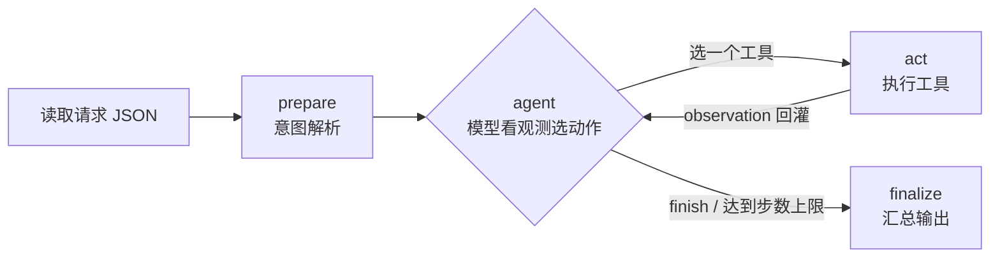

# 方案

## 主流程：ReAct 循环



一次真实运行的骨架（软性冲突，详见 [执行路径记录](../examples/run-records.md)）：

```
agent: 还不知道素材是否存在        → material.get(M01)
act  : 素材存在                    → 观测：存在，最近审核 未审核
agent: 有了素材，该审核了          → audit.check(M01)
act  : PASSED                      → 观测：无风险
agent: 审核通过，查目标日      → slot.query(2026-11-05)
act  : 18:00 被 M00 占            → 观测：19:00、20:00 可用
agent: 用户没说死，找替代          → slot.find_alternative(18:00)
act  : 19:00 / 20:00              → 观测：替代时段
agent: 顺延到 19:00 但要人确认     → schedule.save_draft(M01, 19:00)
act  : 草稿 #2                    → 观测：已保存 DRAFT
agent: 收手，把待确认项交出去      → finish(needs_confirmation)
```

## 模块与判定权

| 模块 | 实现 | 负责什么 | **不**负责什么 |
|---|---|---|---|
| CLI | [src/main.py](../src/main.py) | 入参校验、退出码、决策日志落盘 | 业务判定 |
| 循环 | [src/graph.py](../src/graph.py) | 执行动作、限步、汇总 | 选择动作 |
| 决策 | [src/policy.py](../src/policy.py) | 每轮读观测选出动作或收手 | 执行动作、改数据 |
| 动作 | [src/registry.py](../src/registry.py) | 工具清单、参数校验、观测摘要 | 决策 |
| 工具 | [src/tools.py](../src/tools.py) | 能不能排、是否重复、是否占位 | 决定调用顺序 |
| 规则 | [src/rules.py](../src/rules.py) | 通过 / 缺失 / 风险 | —— |
| 数据 | [src/repository.py](../src/repository.py) · [src/store.py](../src/store.py) | 表读写、唯一键、事务 | —— |

**判定权归属**是这份方案最核心的取舍：模型决定「做什么、什么时候停」，代码决定「事实是什么」。
审核结论、时段占用、幂等都由确定性代码给出，模型即使选错动作也改不了它们，最坏结果是多调几次工具
——而这正好被 `max_steps` 兜住。

## 为什么用 LangGraph

考核要求「模型选择动作 → 执行工具 → 观察结果 → 模型调整下一步」的循环。用 `StateGraph` 表达这个循环：

- `agent ⇄ act` 两条边就是循环本身，条件边只判断「本轮给了动作还是给了终局」，不含业务分支；
- 每轮 state 增量（`decisions` / `observations`）天然构成决策日志，不需要额外埋点；
- 后续要加人工确认（`interrupt`）、并行工具、多轮对话，都是在同一张图上加点加边，不用重写主流程。

没有用多 Agent、向量库或记忆：本任务不需要，加了只是噪音；框架名字也不加分，能解释取舍才有价值。

## 为什么默认用 MockPolicy、真实模型怎么接

- 默认 `MockPolicy` 让评审 `git clone` 就能跑通完整循环，这是「离线 Mock 入口」，边界写在 README 与
  [实现细节](06-implementation.md) §9：**它证明流程，不证明模型决策效果**。
- 真实模型已经接好：`src/clients.py` 的 `DeepSeekClient`（继承 `OpenAICompatibleClient`）负责 HTTP、超时、
  重试与错误码翻译；`LLMPolicy` 把 5 个工具的 JSON Schema 交给模型，读回 `tool_calls`，
  观测以 `tool` 消息回灌——与 `MockPolicy` 共用同一个循环，只换"谁在决定"。
- 切换方式：

  ```sh
  # PowerShell：仅当前会话
  $env:DEEPSEEK_API_KEY = "sk-..."
  python -m src.main --input examples/conflict.input.json --provider deepseek
  ```

  也可用 `LLM_PROVIDER=deepseek` 常驻；模型名 `--model deepseek-flash|deepseek-v4-pro`，
  思考模式 `DEEPSEEK_THINKING=enabled|disabled`。
- 重试只发生在可重试错误上（429/5xx/超时），400/401/402/422 直接失败——重试只会把同一个错误再花钱跑一遍。
  模型层失败时循环 `finish(tool_error)` 并带 `model_error`，不会假装跑通。
- **未用真实 key 联调**：本仓库只验证了报文构造、重试矩阵、失败降级（`tests/test_clients.py` 20 例）。
  联调入口：`python -m scripts.smoke_deepseek --full`。

## 为什么数据放 JSON 而不是直接上 MySQL

交付环境不能假设有数据库服务，而题目又要求保留 MySQL 设计。所以：

- `sql/schema.sql` 保留目标态 DDL（表、唯一键、注释），评审可据此判断建模是否正确；
- `data/seed.json` + `src/store.py` 用单文件实现同样的「表 / 自增 / 唯一键 / 事务 / 锁」；
- `src/repository.py` 是唯一的换库边界，迁 MySQL 只改这一个文件加删掉 `store.py`。

代价是并发上限受文件锁限制（单机、串行），收益是零依赖、评审可 `git clone` 即跑、结论可复现。

## 关键取舍

| 取舍 | 选择 | 理由 |
|---|---|---|
| 决策权 | 交给策略（模型），判定权留给代码 | ReAct 要的是选动作，不是让模型编事实 |
| 冲突时的默认动作 | 请求确认，不自动改期 | 题目明确「未经用户同意不得擅自改变硬性发布要求」 |
| 缺失字段 | 阻断 + 列出缺什么，不填默认值 | 猜错的成本高于让用户补一次 |
| 中低风险 | 存草稿 + 进待确认项 | 不阻断交付，但不能默默通过 |
| 提醒失败 | 降级，不阻断排期 | 通知是旁路，挂了不该让排期失败 |
| 重试 | 仅可重试错误重试一次 | 次数写死在策略里，不让模型自由发挥 |
| 死循环 | `max_steps` 硬上限 → `step_limit_reached` | 有循环就必须有兜底 |
| 重复提交 | 库层唯一键兜底 + 工具层幂等键 | 只靠 prompt 记住「刚提交过」一定不可靠 |
