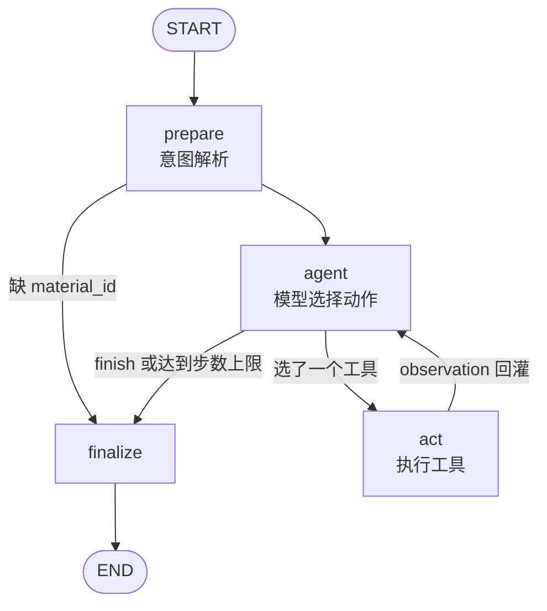
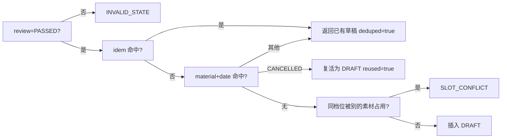

# 实现细节

面向评审：本文说明这套 mock 版「素材审核与发布排期 Agent」是怎么搭的、为什么这么搭、以及哪里还没做完。
配套文件：[需求](01-requirements.md) · [方案](02-solution.md) · [评估](03-evaluation.md) · [MySQL 设计稿](../sql/schema.sql) · [题目原文](../题目.md)

---

## 1. 一句话架构

```
CLI (src/main.py)  --log 写决策日志 JSONL
  └── LangGraph ReAct 循环 (src/graph.py)   prepare → agent ⇄ act → finalize
        ├── 意图解析 src/llm.py      MockLLM（默认）/ HttpLLM（真实模型）
        ├── 决策策略 src/policy.py   MockPolicy（默认）/ LLMPolicy（tool-calling）
        ├── 模型客户端 src/clients.py OpenAI 兼容 / DeepSeek（重试、超时、错误码）
        ├── 动作注册 src/registry.py 5 个工具 + JSON Schema + 观测摘要
        ├── 工具实现 src/tools.py    读素材 / 审核 / 查时段 / 存草稿 / 提醒
        │     ├── 规则判定 src/rules.py  R001–R008 纯函数
        │     └── 数据访问 src/repository.py
        └── 存储     src/store.py    JSON 单文件库（语义对齐 MySQL）
```

**分工原则**：模型负责「选择哪个动作、什么时候收手」，代码负责「动作怎么做、判定是什么」。
审核结论由规则算、时段占用查表、重复由唯一键判——模型即便胡来也改不了这些事实；
它只能决定调用顺序与是否继续，而顺序与是否继续正是 ReAct 要考的东西。

---

## 2. LangGraph 编排（ReAct 循环）

### 2.1 图结构



`agent ⇄ act` 就是 ReAct 的循环：模型读 `observations` 决定下一步；执行结果写回
`observations`；下一轮模型再读。循环里没有写死的业务分支，唯一的硬约束是步数上限。

### 2.2 节点职责

| 节点 | 做什么 | 不做什么 |
| --- | --- | --- |
| `prepare` | 把请求解析成 `intent`（`llm.py`） | 不做业务判定 |
| `agent` | 调 `policy.decide(ctx)`，产出动作或终局；记录 `decisions` | 不执行工具、不碰数据库 |
| `act` | 用 `registry.execute_tool` 执行动作，产出 `observation` | 不决定下一步 |
| `finalize` | 汇总 `decisions`/`observations` 成结果，触发一次提醒 | 不产生新的业务结论 |

### 2.3 模型可选的动作（`src/registry.py`）

| 动作 | 参数 | 返回摘要（模型看到的那句话） |
| --- | --- | --- |
| `material_get` | `material_id` | 素材是否存在、最近审核状态 |
| `audit_check` | `material_id` | `PASSED` / 缺哪些字段 / 命中哪条规则 |
| `slot_query` | `date`, `material_id` | 当天占用情况与可用时段数 |
| `slot_find_alternative` | `slot`, `material_id` | 替代时段列表与占用方 |
| `schedule_save_draft` | `material_id`, `slot` | 草稿 ID / 幂等命中 / 失败原因 |

`finish` 不是数据库动作，由策略直接返回终局，因此不会出现在 `observations` 里。

### 2.4 决策与观测

每轮 `agent` 追加一条 `decisions`，每轮 `act` 追加一条 `observations`：

```jsonc
// decisions[i]
{"step": 4, "action": "slot_find_alternative",
 "args": {"slot": "2026-11-05T18:00:00+08:00", "material_id": "M01"},
 "rationale": "18:00 不可用，先找最近的替代时段再决定",
 "observation": {"ok": true, "summary": "替代时段：19:00、20:00（原档占用方 M00）"},
 "next": "schedule_save_draft"}
```

`next` 到 `finalize` 才补上（当时还不知道下一步），这样一条日志就同时具备
「步骤 / 参数 / 返回摘要 / 后续动作 / 决策依据」。完整示例见
[examples/run-records.md](../examples/run-records.md)。

### 2.5 限步与未完成状态

`max_steps`（默认 10，可用 `--max-steps` 或请求字段覆盖）限制**工具调用次数**。
`agent` 每轮开头检查，达到上限立即 `finish` 成 `step_limit_reached`：

| 字段 | 值 |
| --- | --- |
| `status` | `step_limit_reached` |
| `finished` | `false`（没走完流程） |
| `completed` | `false`（业务目标未达成） |
| `message` | 「达到工具调用上限 N 次仍未得出结论，本次未完成……」 |

对应测试 `test_step_limit_returns_unfinished_state` 与 CLI 用例 `--max-steps 2`。

### 2.6 状态字段

| 字段 | 类型 | 说明 |
| --- | --- | --- |
| `request` | dict | 原始请求（**全程只读**，有测试保证不被修改） |
| `intent` | dict | `material_id` / `desired_slot` / `slot_constraint` / `source` |
| `observations` | list | 每次工具调用的入参、返回摘要、原始 data |
| `decisions` | list | 每轮模型决策 + 依据 + 后续动作 |
| `next` | dict | 本轮待执行的动作，或终局 |
| `trace` | list[str] | `prepare / agent / act:<tool> / finalize` 序列 |

### 2.7 真实模型接入（DeepSeek）

`src/clients.py` 是唯一的 HTTP 层：`OpenAICompatibleClient` + `DeepSeekClient`（继承前者）。
`LLMPolicy` / `HttpLLM` 都只依赖 `ChatClient` 协议，所以换厂商不动循环、换循环不动厂商。

| 项 | 值 |
| --- | --- |
| 端点 | `POST https://api.deepseek.com/chat/completions`（`base_url` 可覆盖） |
| 模型 | `deepseek-flash`（默认）/ `deepseek-v4-pro` |
| 工具 | `tools` + `tool_choice=auto`；思考模式下不允许 `required` 或指定具体 tool（会 400） |
| 思考模式 | 省略参数时服务端默认开启，所以"关闭"必须显式传 `thinking: {"type": "disabled"}` |
| 推理内容 | `reasoning_content` 只读不回传，避免下一轮把思维链喂回去 |
| 用量 | `usage` 归一成整型计数，逐轮累加进输出的 `llm_usage` |

重试与错误翻译（可重试才重试，指数退避 0.5s 起、上限 8s、默认 2 次，尊重 `Retry-After`）：

| HTTP | 错误码 | 重试 |
| --- | --- | --- |
| 400 | `BAD_REQUEST` | 否 |
| 401 | `AUTH` | 否 |
| 402 | `INSUFFICIENT_BALANCE` | 否 |
| 422 | `INVALID_PARAMETERS` | 否 |
| 429 | `RATE_LIMITED` | 是 |
| 500 / 502 / 503 / 504 | `SERVER_ERROR` / `SERVER_BUSY` | 是 |
| 超时 / 连接失败 | `TIMEOUT` / `NETWORK` | 是 |

配置（全部走环境变量，仓库内不含密钥）：

| 变量 | 默认 | 说明 |
| --- | --- | --- |
| `LLM_PROVIDER` | `mock` | `mock` / `deepseek` / `http` |
| `DEEPSEEK_API_KEY` | — | 必填；也兼容 `LLM_API_KEY` |
| `DEEPSEEK_BASE_URL` | `https://api.deepseek.com` | 可指向代理 |
| `DEEPSEEK_MODEL` | `deepseek-flash` | 也可用 `deepseek-v4-pro` |
| `DEEPSEEK_THINKING` | `disabled` | `enabled` 时自动去掉 `temperature` |
| `DEEPSEEK_REASONING_EFFORT` | 空 | `none/low/high/max`，设置后覆盖 THINKING |
| `DEEPSEEK_TIMEOUT` | `60` | 单次请求秒数 |
| `DEEPSEEK_MAX_RETRIES` | `2` | 重试次数 |

模型层失败时循环不会崩：`_agent` 捕获 `ChatError` 后 `finish(tool_error)`，
输出里带 `model_error{code,status,retryable}`，并保证 `published=false`、不落草稿。

**已用真实 key 联调**（2026-10-30，`deepseek-flash`，`thinking=disabled`），3 条路径的结论与 mock 一致：
软性冲突 6 步存草稿 19:00、硬性冲突 4 步 `blocked`、信息缺失 5 步 `needs_input`。
记录见 [examples/run-records.md](../examples/run-records.md#真实模型记录deepseek-deepseek-flash)、
[docs/03](03-evaluation.md)。手动复跑：`python -m scripts.smoke_deepseek --full`。

联调打出的两条真实约束（已修复，离线 mock 测不到）：

| 现象 | 根因 | 处理 |
| --- | --- | --- |
| `400 Invalid 'tools[0].function.name'` | function name 只允许 `^[a-zA-Z0-9_-]+$`，原来的 `material.get` 带点号 | 工具名统一改下划线，源码/文档/记录同步 |
| `needs_confirmation` 但 `draft.saved=false` | 模型不存草稿就 `finish` | prompt 规则 7 + `finalize` 兜底降级为 `blocked` |

配置来源：`os.environ` 优先，其次读取仓库根 `.env`（`src/env.py`，支持行尾注释、引号、`export`），
可用 `--env-file` 指定其它文件。

---

## 3. 数据层：JSON 文件库如何对齐 MySQL

### 3.1 为什么不用 sqlite

题目要求保留 MySQL 设计，但交付环境不能连数据库服务。`store.py` 只实现真正用到的四件事——表、自增主键、唯一键、事务——语义与 `sql/schema.sql` 一致，换库时只替换本模块和 repository 的驱动，业务代码零改动。

### 3.2 表与约束映射

| MySQL | JSON 库（`data/seed.json`） |
| --- | --- |
| `materials` 表 | `tables.materials[]` |
| `material_review` 表 | `tables.material_review[]` |
| `publish_schedule` 表 | `tables.publish_schedule[]` |
| `notify_log` 表 | `tables.notify_log[]` |
| `AUTO_INCREMENT` | `sequences.<table>`，`Session.next_id()` 自增 |
| `UNIQUE KEY uk_material_date (material_id, date)` | `TableSpec.unique=("material_id","date")` |
| `UNIQUE KEY uk_idem (idem_key)` | `TableSpec.unique=("idem_key",)` |
| `DATETIME` | 带偏移的 ISO 8601 字符串，统一 `+08:00` |
| 事务提交 | 写 `db.json.tmp` 后 `os.replace` 原子替换 |
| 事务回滚 | 只操作内存副本，异常时不落盘 |
| 表锁 / 行锁 | 独占锁文件 `db.json.lock`（`O_CREAT\|O_EXCL`），超时 5s |

两处刻意的 MySQL 语义对齐：

- **唯一索引允许多个 NULL**：`publish_schedule.idem_key` 允许为空（种子数据就是空），判重只比较全部非 NULL 的组合，避免把多条 `NULL` 误判成重复。
- **`update` 也要过唯一校验**：作废后重排同一时段会复用原行，改 `status`/`idem_key` 前仍要校验，避免把自己写进冲突。

### 3.3 并发与原子性

```python
with db.transaction() as session:      # 1) 抢锁 2) 读全库 3) 改内存
    ...
# 正常退出：data != snapshot 才落盘（原子替换）
# 抛异常：直接丢弃，磁盘保持上一次的完整内容
```

8 线程并发写 8 行的测试（`test_concurrent_writers_do_not_lose_rows`）验证了不丢行、不撕裂。
锁文件可能因进程被杀而残留，超过 30s 视为陈旧并回收（`_is_stale_lock`）。

锁实现里有一处 Windows 特有的坑，必须显式处理：

| 情况 | 该拿到的异常 | 实际可能拿到 |
| --- | --- | --- |
| 锁文件已存在且被占用 | `FileExistsError` | `FileExistsError` |
| 锁文件正被另一个持有者删除（delete-pending） | —— | `PermissionError(13)` |

第二种情况下 `O_CREAT|O_EXCL` 返回 `ERROR_ACCESS_DENIED`，语义上仍然是「锁被占用」。
若不捕获，它会在多线程写时以约 5% 的概率冒到调用方（实测 20 轮复现 1 次），
所以 `_file_lock` 把 `PermissionError` 也当作「等待后重试」，超时才抛 `LockTimeout`——后者由
`tools.py` 翻译成可重试的 `DB_UNAVAILABLE`，不会变成 500。
回归测试：`test_permission_denied_on_lock_is_retried`、`test_persistent_permission_denied_raises_lock_timeout`；
压力脚本：`python -m scripts.stress_lock 50 12`（50 轮 × 12 线程，0 失败）。

### 3.4 事务粒度

每个工具自己开一个短事务，等价于 MySQL 的逐条提交：

- 审核结果写 `material_review`（一素材一行，upsert）；
- 草稿写 `publish_schedule`；
- 提醒写 `notify_log`。

这样「保存失败」只回滚保存那一步——审核结论仍然留下（这符合真实语义：审核已发生），但排期表里不会出现半行。

---

## 4. 工具契约

所有工具返回 `ToolResult{ok, data, code, message, retryable}`，**不向图抛业务异常**。
`registry.execute_tool(name, args, ctx)` 是模型动作的唯一入口，返回 `(ToolResult, 摘要)`；
摘要就是模型下一轮看到的 `observation.summary`。

| 模型动作 | 实现函数 | 关键行为 | 错误码 |
| --- | --- | --- | --- |
| `material_get` | `material_get` | 读元数据 + 最近审核结论 | `NOT_FOUND` / `SOURCE_UNAVAILABLE` |
| `audit_check` | `audit_check` | 跑 R001–R008 并 upsert `material_review` | `RULES_UNAVAILABLE` |
| `slot_query` | `slot_query` | 天粒度，返回 `free/occupied/closed` | `DB_UNAVAILABLE` |
| `slot_find_alternative` | `find_alternatives` | 先顺延、再提前，最多 2 个 | 同上 |
| `schedule_save_draft` | `schedule_save_draft` | 幂等 + 容量校验 + 复活 CANCELLED | `SLOT_CONFLICT` / `INVALID_STATE` / `DB_UNAVAILABLE` / `DB_WRITE_REJECTED` |
| （框架动作）| `schedule_confirm` / `notify_push` | 确认草稿 / 提醒幂等 | `CHANNEL_UNAVAILABLE` |

`audit_check` 审的是 `material_get` 刚返回的那份快照（存在 `ToolContext.observed_metadata` 里），
而不是重新读库——否则「上游元数据延迟」这类场景审核永远看不到缺字段，补查就成了摆设。

### 4.1 幂等键

```
idem_key = sha256("{material_id}|{slot_iso}|{rules_version}")
```

三层防护，任意一层失效都还有下一层：

1. `find_schedule_by_idem` 提前返回已有草稿；
2. `uk_idem` 唯一键兜底（并发下第二个请求被拒后翻译成「复用」）；
3. `uk_material_date` 保证同素材同时段只一行。

### 4.2 保存草稿的判定顺序



### 4.3 一个真实踩过的坑（已修复并加测试）

第一版 `slot_query` 把「自己上一次提交的草稿」也算成占用，导致：

> 同一请求提交第二次 → 20:00 被「M02 自己」占用 → 顺延到 21:00 → **产出第二份草稿**。

也就是说，幂等校验写在了保存层，但冲突判断更早把请求推到了另一个时段，根本没走到幂等。
修复方式是给 `slot_query` 加 `exclude_material`：同一素材自己的占位不算冲突。
对应测试 `test_duplicate_submission_creates_one_draft` 与示例 `examples/duplicate.*`：
两次提交都落到 `draft_id=2`、`deduped=true`、表里只有一行。

这条也解释了为什么「重复提交」必须作为独立验收项——它不是幂等键一行代码的事。

---

## 5. 决策规则

### 5.1 审核结论

| 条件 | 结论 | 处置 |
| --- | --- | --- |
| 有必填字段缺失（R001/R002/R003/file_url） | `INCOMPLETE` | 补查 1 次；仍缺 → 阻断，列出字段 |
| 有 HIGH 风险（R005 敏感词 / R008 格式） | `RISK` | 阻断，返回规则码与整改建议 |
| 只有 MEDIUM/LOW（R004 版权、R006 标题长、R007 无标签） | `PASSED` | 继续，但写入待确认项 |
| 无 | `PASSED` | 直接排期 |

优先级：**信息缺失 > 高危风险 > 通过**。同时缺封面又踩敏感词时先让用户补字段——补完还要再过一遍风险，省得改两轮。

### 5.2 时段冲突

| 情况 | 判定 | 动作 |
| --- | --- | --- |
| 目标时段 `free` | 无冲突 | 直接用 |
| 被别的素材占用 + 软性要求 | `needs_confirmation` | 顺延到最近可用，存草稿，标待确认 |
| 被别的素材占用 + 硬性要求 | `blocked` | **不改期**，返回冲突详情 + 改期/取消/换素材三个选项 |
| 超出窗口或已过期 | 同上，按硬/软分流 | 同上 |
| 当天无任何可用时段 | `blocked` | 明确说无可用时段 |

硬性判定：请求显式给 `slot_constraint`，或文本命中「必须/只能/务必/一定要/不得调整/不能改」。
软性关键词「希望/最好/建议/尽量/如果可以」显式记为软，其余默认软（**默认不擅自改用户时间**）。

### 5.3 提醒

| 事件 | 触发 |
| --- | --- |
| `review_incomplete` | 信息缺失被阻断 |
| `review_blocked` | 高危风险 / 硬性冲突被阻断 |
| `confirm_needed` | 草稿已存但有待确认项 |
| `draft_saved` | 草稿已存且无待确认项 |

`dedupe_key = "{material_id}:{event}:{slot}"`，24h 内同键只发一条（当前实现按 `uk_dedupe` 永久去重，够用）。
提醒失败**不影响排期**：`notify.degraded=true`，同样内容已在回复的 `pending_confirmations`/`message` 里。

---

## 6. 输出契约

| 字段 | 取值 | 说明 |
| --- | --- | --- |
| `status` | 见下表七种 | 覆盖全部验收场景 |
| `finished` | `true` / `false` | 是否走完流程；仅 `step_limit_reached` 为 `false` |
| `completed` | `true` / `false` | 业务目标是否达成（`completed` / `needs_confirmation` 为真） |
| `review_status` | `PASSED` / `INCOMPLETE` / `RISK` / `UNKNOWN` | `UNKNOWN` 仅出现在素材都没读到的时候 |
| `published` | **恒为 `false`** | 结构性保证：没有任何代码路径写 `PUBLISHED` 或 `release_date` |
| `draft` | `{saved, draft_id, status, deduped, reused}` | `saved=false` 时没有其它字段 |
| `pending_confirmations` | `list[str]` | 人话，可直接展示给用户 |
| `steps` / `tool_calls` / `max_steps` | 整数 | 决策步数、实际工具调用数、上限 |
| `decisions` | `list[dict]` | 每步的动作、参数、观测摘要、后续动作、决策依据 |
| `trace` | `list[str]` | `prepare / agent / act:<tool> / finalize` |

`status` 与「用户看到的结论」一一对应，不会出现「保存失败但说已完成」：

| status | 含义 | 是否落库 |
| --- | --- | --- |
| `completed` | 草稿已保存，无待确认 | 是 |
| `needs_confirmation` | 草稿已保存，但有待确认项 | 是 |
| `needs_input` | 素材信息缺失，阻断 | 否（仅审核结论） |
| `blocked` | 规则风险或硬性冲突 | 否 |
| `not_found` | 素材不存在 | 否 |
| `tool_error` | 工具失败（含保存失败） | 否 |
| `step_limit_reached` | 达到工具调用上限，**本次未完成** | 否 |

CLI 约定：业务状态一律退出码 0；只有**入参本身不合法**才退出码 2 并输出 `{"status":"invalid_input","error":...}`。

---

## 7. 故障注入（`simulate`）

mock 模式没有真实网络和数据库，验收靠注入：

| 字段 | 值 | 效果 |
| --- | --- | --- |
| `simulate.material_lookup` | `true` | 读素材返回 `SOURCE_UNAVAILABLE`（可重试） |
| `simulate.rules_unavailable` | `true` | 规则加载失败 → 保守阻断（不放行） |
| `simulate.save_failure` | `db_unavailable` | 保存失败，可重试；重试 1 次仍失败 → `tool_error` |
| `simulate.save_failure` | `db_write_rejected` | 不可重试失败，直接 `tool_error` |
| `simulate.notify_failure` | `true` | 提醒失败，排期照常 |
| `simulate.metadata_lag_once` | `true` | 首次读缺 `cover_url`，补查后完整（演示「补查→重审」链路） |

可重试错误只重试一次：模型看到 `retryable=true` 才会重发同一动作，第二次仍失败就收手。
重试次数由策略固定，不让模型自己决定重试几轮。

---

## 8. 测试策略

`python -m unittest discover -s tests -v`，96 个用例，分层覆盖：

| 层 | 文件 | 覆盖点 |
| --- | --- | --- |
| 存储 | `tests/test_store.py` | 唯一键、NULL 语义、自增、回滚不落盘、原子写、8 线程并发、锁 PermissionError 重试 |
| 规则 | `tests/test_rules.py` | R001–R008 逐条、缺失优先于风险、metadata 为 None |
| 意图 | `tests/test_llm.py` | 结构化优先、文本回退、硬/软识别、非法输入、HttpLLM 报文解析 |
| 流程 | `tests/test_workflow.py` | 六类验收 + 补查恢复 + 提醒降级 + 取消复活 + 限步未完成 + 决策日志字段 + 假模型驱动循环 |
| CLI | `tests/test_cli.py` | 退出码、`invalid_input`、BOM 容错、跨进程幂等、`--now`/`--compact`/`--max-steps`/`--log` |

每个用例一份独立临时库（`tests/support.py`），互不污染；`examples/*.output.json` 由 `python -m scripts.regen_examples` 真实跑出来，不是手写。

---

## 9. 已知限制

| 项 | 现状 | 真实化要做什么 |
| --- | --- | --- |
| 决策模型 | 默认 `MockPolicy`；DeepSeek 已用真实 key 跑通 3 条路径 | 只测了 `deepseek-flash` 单模型单次，稳定性与质量仍需更多样本 |
| 配置加载 | 支持 `.env`（行尾注释/引号/export），环境变量优先 | 不支持变量插值与多行值 |
| 存储 | 单文件 JSON + 文件锁 | 换 MySQL：repository 方法体改 SQLAlchemy，`store.py` 整体替换 |
| 并发 | 文件锁串行，单机有效 | MySQL 下用 `SELECT … FOR UPDATE` + 唯一键 |
| 容量 | 一个时段 1 条 | `publish_window.capacity` 尚未实现 |
| 发布 | 不触发真实发布 | 外部系统回写 `PUBLISHED` 与 `release_date` |
| 时区 | 固定 `Asia/Shanghai` | 跨时区需在入口归一 |
| 批量 | 一次一个素材 | 上层循环，任一失败不阻塞其余 |
| 并行工具 | `act` 一次只执行一个动作 | 真实模型会给多个 tool_calls，需要改成并行分支 |

迁移到 MySQL 的顺序：建 `sql/schema.sql` → 实现 `repository` 的 MySQL 版 → 删掉 `store.py` 的锁与原子写 → 其余代码不动 → 跑同一套 96 个测试。

---

## 10. 文件索引

| 关注点 | 文件 |
| --- | --- |
| 入口与退出码 | [`src/main.py`](../src/main.py) |
| ReAct 循环与限步 | [`src/graph.py`](../src/graph.py) |
| 决策策略（Mock / LLM） | [`src/policy.py`](../src/policy.py) |
| 模型客户端（DeepSeek / OpenAI 兼容） | [`src/clients.py`](../src/clients.py) |
| `.env` 加载 | [`src/env.py`](../src/env.py) |
| 动作注册表与观测摘要 | [`src/registry.py`](../src/registry.py) |
| 工具实现 | [`src/tools.py`](../src/tools.py) |
| 审核规则 | [`src/rules.py`](../src/rules.py) |
| 意图解析 | [`src/llm.py`](../src/llm.py) |
| 数据访问 | [`src/repository.py`](../src/repository.py) |
| JSON 库 | [`src/store.py`](../src/store.py) |
| MySQL 设计稿 | [`sql/schema.sql`](../sql/schema.sql) |
| 种子数据 | [`data/seed.json`](../data/seed.json) |
| 执行路径记录 | [`examples/run-records.md`](../examples/run-records.md) |
| DeepSeek 联调脚本 | [`scripts/smoke_deepseek.py`](../scripts/smoke_deepseek.py) |
